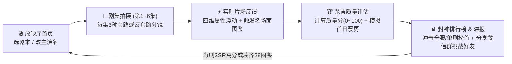
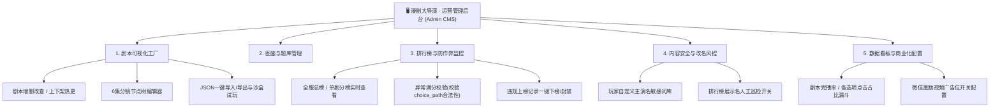

# 《漫剧大导演》微信小程序（uni-app + 管理端）产品与技术开发总文档

> **文档版本**：v1.0.0  
> **目标平台**：微信小程序（基于 `uni-app` Vue3 + TypeScript 开发，支持后续一键编译抖音/快手小程序及 H5）  
> **核心定位**：「单机爽文短剧反套路互动」+「拍摄质量/票房评分体系」+「多维导演排行榜社交攀比」  
> **配套剧本数据文件**：`./SCRIPTS_DATABASE.json`

---

## 一、 产品核心玩法与「拍摄质量攀比」机制设计

原版 H5 小游戏（bilibili TOY《漫剧大导演》）仅包含基础的「选剧本 -> 6集选项 -> 4种结局 -> 28图鉴收集」单机循环。为了在微信小程序生态中形成**高留存、高复玩、高裂变攀比**，我们将玩家身份从单纯的“选支线观众”升级为**「短剧总导演兼领衔主演」**：

### 1.1 核心玩法闭环



### 1.2 四维拍摄属性与「拍摄质量分 / 票房」算法（核心攀比引擎）

玩家在 6 集中的每一次选择，不仅决定结局走向，还会实时影响本剧的**四维拍摄指标**：

| 属性字段 | 名称 | 含义与作用 | UI 表现色彩 |
| :--- | :--- | :--- | :--- |
| `thrill` | 🔥 **爽感值（狗血度）** | 打脸反派、掉马甲、豪门恩怨的爽快程度 | 芭比猛男粉 `#FF5E97` |
| `absurd` | 🤪 **脑洞值（离谱度）** | 反套路整活、神转折、引发弹幕刷屏的荒诞程度 | 荧光薄荷绿 `#00E5A3` |
| `persona` | 🎭 **演技值（人设感）** | 角色行为风格的一致性或极致反差感 | 电光亮紫 `#7C5CFF` |
| `budget` | 💰 **排面值（经费度）** | 剧组特效、劳斯莱斯/直升机等大场面调度 | 奶油鹅黄 `#FFC93C` |

#### 综合拍摄质量分（Quality Score：$0 \sim 100$ 分）计算公式：
$$Score = \text{Base}(40) + \sum_{i=1}^{6} \text{ChoiceBonus}_i + \text{StyleComboBonus} + \text{EndingRarityBonus} + \text{RandomCrit}(-2.0 \sim +3.5)$$

1. **分镜基础分（$\sum \text{ChoiceBonus}_i$）**：每集每个选项自带 `12 ~ 22` 分隐藏质量权重（反套路、高戏剧冲突选项分值更高）。
2. **导演风格连击加成（$\text{StyleComboBonus}$）**：
   * **「荒诞鬼才导演」**：连续 4 集以上选择高 `absurd`（反套路）选项，额外 `+8.0` 分。
   * **「爽片 orthodox 大师」**：连续 4 集以上选择高 `thrill`（经典打脸）选项，额外 `+6.0` 分。
   * **「端水大师（烂片警告）」**：一会儿正经一会儿离谱导致四维平庸，无风格加成（只能拿 65~78 分普通评价，刺激玩家重刷极致路线！）。
3. **结局稀有度加成（$\text{EndingRarityBonus}$）**：
   * `UR 隐藏神结局`：`+18` 分
   * `SSR 荒诞反套路结局`：`+15` 分
   * `SR 经典爽文结局`：`+10` 分
   * `R 普通结局`：`+6` 分
4. **模拟票房 / 全网播放量换算（极具视觉冲击力的攀比指标）**：
   * $95 \sim 100$ 分（**SSR · 现象级神剧**）：预估播放量 `3.0亿 ~ 9.9亿`，获评「短剧界诺兰」
   * $85 \sim 94$ 分（**S · 爆款热播剧**）：预估播放量 `8000万 ~ 2.9亿`，获评「横店金牌导演」
   * $70 \sim 84$ 分（**A · 下饭爽剧**）：预估播放量 `1000万 ~ 7900万`，获评「合格流水线导演」
   * $< 70$ 分（**B/C · 扑街烂片**）：预估播放量 `50万`，获评「建议退圈去开食堂」

### 1.3 三大排行榜与社交裂变攀比体系

为了最大化激发玩家的胜负欲与分享欲，设计以下三个维度的排行榜：

1. **🎬 单剧最高质量榜（核心攀比榜）**
   * 按每部剧本（如《赘婿龙王》《真假千金》）独立排名前 100 名。
   * **上榜展示信息**：`排名` + `导演微信头像/昵称` + `自定义主演姓名` + `达成结局标签` + `拍摄质量分（精确到小数点后两位，如 98.65 分）` + `预估播放量（8.4亿）`。
   * **攀比爽点**：玩家可以把主演改成自己或损友的名字（经微信安全接口过滤），一旦冲上榜单前排，全服玩家都能看到**「主演：张三 · 结局：入赘三年开食堂（98.65分）」**！
2. **🏆 全服百亿导演总榜（长线留存榜）**
   * 按玩家所有拍摄剧目的**累计总播放量（最高分总和）**及**图鉴收集率（X/28）**排名。
3. **⚔️ 好友 PK 挑战卡（微信群裂变引擎）**
   * 杀青结算页点击「晒战报 / 发起挑战」，分享卡片标题自动生成：
     > *“我拍的《赘婿龙王》拿了 96.8 分（4.2亿播放），击败全国 99.1% 的导演！你敢来重拍一版吗？”*
   * 好友从分享卡片点进小程序时，顶部常驻挑战横幅：**`🔥 正在挑战好友 [XXX] 的 96.8 分纪录`**，杀青后直接弹出两人的分数对比胜负卡！

---

## 二、 剧本数据爬取说明与 4 部完整改编剧本规划（28 图鉴体系）

### 2.1 原网页剧本提取说明与辅助脚本
1. **为什么未直接穿透拉取 `bilibilitoy.com` 原始文本**：
   * 原游戏页面在 `bilibili.com` 外层套了跨域子框架 `https://www.bilibilitoy.com/toy/duanju-rensheng/index.html`，当前沙盒环境对跨域子框架存在访问拦截（`ORIGIN_PERMISSION_REQUIRED`）。
   * **版权合规建议**：由于我们的目标是**正式上架微信小程序**，一字不差照搬原作者文案存在著作权投诉下架风险。因此**「保留其 6集×4结局×28图鉴 的黄金骨架与热梗切入点，进行网感化二次原创改编」**是最安全且效果最好的方案。
2. **附：如果您在本地浏览器想一键导出原网页内部数据**：
   * 您只需在电脑浏览器打开原链接，按 `F12` 打开开发者工具 -> 顶部控制台切换上下文从 `top` 切换到 `bilibilitoy.com` 子框架，粘贴以下脚本即可自动下载原网页内存或 DOM 中的文本：
   ```javascript
   // 在浏览器 DevTools Console (选择 bilibilitoy.com iframe 上下文) 中执行：
   (() => {
     const scripts = Array.from(document.querySelectorAll('script')).map(s => s.src || s.innerText);
     console.log('Detected Scripts:', scripts);
     // 抓取当前页面所有可见文案与全局配置对象
     const dump = {
       title: document.title,
       text: document.body.innerText,
       localStorage: { ...localStorage }
     };
     console.save ? console.save(dump) : console.log(JSON.stringify(dump, null, 2));
   })();
   ```

### 2.2 改编版 4 大爆款剧本与「28 图鉴」完整矩阵

原版首屏显示 `我的图鉴 0/28`，且每个剧本固定为 `共 6 集`、`4 种结局`。我们据此规划 **4 部首发王牌剧本**，每部剧本包含 **4 个结局图鉴 + 3 个局内名场面彩蛋图鉴 = 7 个图鉴**，$4 \times 7 = 28$ 个图鉴，严丝合缝！

| 剧本编号 | 剧本名称 | 题材标签 | 4 大结局图鉴 (16个) | 3 大名场面道具/彩蛋图鉴 (12个) | 状态 |
| :--- | :--- | :--- | :--- | :--- | :--- |
| **剧本 01** | **《赘婿龙王：三年之期》** | 男频爽剧 / 推荐 | ① 入赘三年，结局是开食堂？(SSR)<br>② 超级辈分王：我娶我自己孙女？(UR)<br>③ 至尊歪嘴战神：三年之期已到(SR)<br>④ 折叠凳代言人：豪门整顿大师(R) | 🪑 红色塑料折叠凳<br>🍜 寿宴加臭螺蛳粉<br>🥢 原汁原味九转大肠 | **已完成全6集完整剧本**（见 `SCRIPTS_DATABASE.json`） |
| **剧本 02** | **《真假千金：DNA动了》** | 女频狗血 / 推荐 | ① 真假千金联手，把豪门买下来了！(SSR)<br>② 豪门流水席：万物皆可杀猪菜(UR)<br>③ 满级马甲女王：莫欺少女穷(SR)<br>④ 全员恶人改造营：豪门变形计(R) | 🩸 旋转楼梯番茄酱假摔<br>📚 豪门五三高考模拟卷<br>🎺 送走未婚夫的百鸟朝凤唢呐 | **已完成全6集完整剧本**（见 `SCRIPTS_DATABASE.json`） |
| **剧本 03** | **《霸总逼我签协议：带球跑》** | 豪门虐恋 / 萌宝 | ① 萌宝黑客把霸总公司干破产了(SSR)<br>② 带球跑？我带的是国足青训队！(UR)<br>③ 追妻火葬场：霸总在雨夜跪搓衣板(SR)<br>④ 搞钱大女主：五百万支票真香(R) | 📄 镶钻版离婚协议书<br>⚽ 三胞胎天才足球小将<br>🌧️ 霸总专属人工降雨洒水车 | 已完成结构设计，支持后台一键导入 |
| **剧本 04** | **《重生之我在豪门当保姆》** | 银发爽剧 / 逆袭 | ① 保姆竟是千亿集团幕后太皇太后(SSR)<br>② 带领豪门全家跳广场舞称霸全国(UR)<br>③ 恶毒少奶奶被罚每天洗十吨衣服(SR)<br>④ 金牌月嫂：整顿京圈家政市场(R) | 🧹 镶金边尚方宝剑鸡毛掸子<br>📻 震慑全场的广场舞低音炮<br>🍲 喝了就说真话的王妈鸡汤 | 已完成结构设计，支持后台一键导入 |

---

## 三、 UI 视觉风格还原与改编规范（Neo-Brutalism 波普手账风）

参照原版截图的视觉精髓，我们提炼出一套适合 `uni-app` 微信小程序的 **Neo-Brutalism（新粗野主义 / 波普漫画手账风）** 样式规范。这种风格最大的优势是**不需要复杂的 3D 建模或重度贴图，完全依靠 CSS 粗描边、实心硬阴影和高饱和撞色就能做出极强的精致感与年轻化网感**。

### 3.1 全局色彩与样式变量 (`uni.scss`)

```scss
/* 1. 背景与网格纸纹理 */
$bg-paper: #FFF6F8;          // 浅粉奶油底色
$bg-grid-line: #F2E2E8;      // 方格纸线条颜色
$card-bg-white: #FFFFFF;     // 卡片纯白底色

/* 2. 核心粗描边与硬阴影（灵魂所在） */
$ink-navy: #1E2246;          // 标志性深藏青描边色（替代纯黑，更高级）
$border-thick: 4rpx solid #1E2246;
$border-heavy: 6rpx solid #1E2246;
$shadow-card: 0 8rpx 0 #1E2246;       // 卡片底部实心硬阴影
$shadow-btn: 0 6rpx 0 #1E2246;        // 按钮实心硬阴影
$shadow-btn-active: 0 2rpx 0 #1E2246; // 按钮按下位移反馈

/* 3. 波普撞色主题色盘 */
$pop-pink: #FF6B9E;          // 主按钮/推荐角标（芭比粉）
$pop-purple: #845EC2;        // 剧字块/标签（波普紫）
$pop-cyan: #2CD3E1;          // 人字块/信息胶囊（薄荷青）
$pop-green: #4ECCA3;         // 生字块/正向反馈（果冻绿）
$pop-yellow: #FFE66D;        // 奖杯/高分印章（奶油黄）
```

### 3.2 标志性方格纸背景与波普按钮通用 Class

```scss
/* 方格纸页面容器 */
.paper-grid-page {
  min-height: 100vh;
  background-color: #FFF6F8;
  background-image: 
    linear-gradient(#F2E2E8 2rpx, transparent 2rpx),
    linear-gradient(90deg, #F2E2E8 2rpx, transparent 2rpx);
  background-size: 40rpx 40rpx;
  color: #1E2246;
}

/* 波普风主卡片 */
.pop-card {
  background: #FFFFFF;
  border: 5rpx solid #1E2246;
  border-radius: 36rpx;
  box-shadow: 0 10rpx 0 #1E2246;
  padding: 32rpx;
}

/* 波普风胶囊按钮（带按压下沉物理动效） */
.pop-btn-primary {
  background: #FF6B9E;
  color: #1E2246;
  font-weight: 900;
  border: 5rpx solid #1E2246;
  border-radius: 999rpx;
  box-shadow: 0 8rpx 0 #1E2246;
  transition: transform 0.08s ease, box-shadow 0.08s ease;
  
  &:active {
    transform: translateY(6rpx);
    box-shadow: 0 2rpx 0 #1E2246;
  }
}
```

### 3.3 界面结构改编升级点（超越原版的部分）

1. **首屏（放映厅）升级**：
   * 保留原版的顶部「🏆 排行榜/成就」「🔇 静音」「⚙️ 设置」三颗圆形粗描边按钮。
   * 保留「放映厅 · 互动短剧」粉色胶囊顶标与 `[短][剧][人][生]` 四色方块字 Logo。
   * **新增「全服最新神剧跑马灯」**：在顶部滚动播报 `*“恭喜导演 [阿强] 拍出 98.5 分 SSR《赘婿龙王》，斩获 6.2 亿播放！”*`，一进游戏就营造强烈的攀比氛围。
2. **局内（拍摄现场页）设计**：
   * **顶部场记板（Clapperboard）状态栏**：显示 `第 3/6 集` + 当前实时预估热度条。
   * **中部像素/Q版插画剧照框 + 动态弹幕层**：当玩家做出离谱选择后，插画上方飘过 3~5 条搞笑模拟网友弹幕（如 `“？？？这剧本不对吧”` `“大舅哥连夜买站票逃跑”`）。
   * **底部选项卡片**：每个选项点击后，立即弹出**「导演回放点评卡」**与**「属性加分飘字（脑洞+35 / 质量分+19）」**，然后再进入下一集。
3. **杀青结算页（参照原版右侧视频封面强化）**：
   * 顶部「杀青大吉 · 剧集检验报告」。
   * 核心大字展示 **综合质量评分（如 `94.5` 分）+ 进度条 + 击败全国 `96%` 导演**。
   * 展示本次达成的结局插画、结局称号、网友神评，以及本局新解锁的图鉴徽章。
   * 底部双按钮：「冲击排行榜 / 晒海报炫耀」+「换个选法重拍」。

---

## 四、 技术架构与目录规划（uni-app + 管理后台）

### 4.1 整体技术选型建议

针对需要**「单机流畅体验 + 记录用户拍摄质量排名 + 配套管理后台 + 上架微信小程序」**的需求，提供两套后端与管理端落地方案，推荐优先采用 **方案 A（uniCloud 全栈同构）** 或 **方案 B（Node.js/Java + Vue3 Admin）**：

| 维度 | 方案 A：uni-app + uniCloud + uni-admin（强烈推荐） | 方案 B：uni-app + NestJS/SpringBoot + ElementPlus Admin |
| :--- | :--- | :--- |
| **开发成本与速度** | ⭐⭐⭐⭐⭐ 极快，前后端同仓库同语言，免运维服务器与域名备案 | ⭐⭐⭐ 需自备云服务器、已备案域名、SSL证书及运维部署 |
| **微信小程序免登录** | 天然支持微信 `openid` 静默获取，无需复杂登录流 | 需自行对接 `wx.login` 换取 `code2Session` 并签发 JWT |
| **管理端（Admin）** | 官方现成 `uni-admin` 框架，自带权限管理，可直接可视化编辑剧本 JSON | 使用 `Vue3 + Vite + Element Plus` 搭建独立后台管理系统 |
| **单机+弱网兼容** | 剧本 JSON 支持本地缓存 + 云端版本号热更新，断网也能单机玩，联网自动上报成绩冲榜 | 同左 |

### 4.2 小程序前端目录结构 (`uni-app` Vue3 + Pinia)

```text
duanju-miniprogram/
├── src/
│   ├── pages/
│   │   ├── index/index.vue          # 放映厅首页（选剧本、改主演名、入口区）
│   │   ├── episode/episode.vue      # 剧集拍摄页（6集核心互动、弹幕、点评弹窗）
│   │   ├── ending/ending.vue        # 杀青结算页（质量评分、票房、Canvas生成海报）
│   │   ├── rank/rank.vue            # 封神排行榜页（全服总榜、单剧分榜、我的战绩）
│   │   └── pokedex/pokedex.vue      # 我的图鉴页（28个结局与名场面收集册）
│   ├── components/
│   │   ├── PopHeaderBar.vue         # 顶部奖杯/音效/设置栏
│   │   ├── ScriptCarousel.vue       # 剧本卡片切换组件
│   │   ├── RenameModal.vue          # 主演/配角改名弹窗（含微信敏感词校验）
│   │   ├── DanmakuOverlay.vue       # 剧照上方模拟搞笑弹幕组件
│   │   └── PosterPainter.vue        # 杀青炫耀战报 Canvas 绘图组件
│   ├── stores/
│   │   ├── useGameStore.ts          # 当前拍摄局状态机（当前集、四维属性、已选路径）
│   │   └── useUserStore.ts          # 玩家档案（主演名、已解锁图鉴28、历史最高分）
│   ├── utils/
│   │   ├── scoreCalculator.ts       # 拍摄质量分 & 票房 & 结局判定核心算法
│   │   ├── audioManager.ts          # BGM与按键/打脸/唢呐音效控制器
│   │   └── storageSync.ts           # 本地缓存与云端排行榜异步同步工具
│   └── static/
│       ├── scripts/                 # 内置兜底剧本 JSON（支持离线秒开）
│       ├── images/                  # 像素插画与波普 UI 图标
│       └── audio/                   # 搞笑音效资源
```

---

## 五、 数据库表结构与管理端（Admin CMS）功能设计

无论是使用 `uniCloud (MongoDB/JSON Schema)` 还是 `MySQL`，核心只需 **5 张数据表**即可支撑完整业务：

### 5.1 核心数据库表结构

#### 1. `dj_scripts`（剧本主表 —— 支持管理端热更新剧本）
| 字段名 | 类型 | 说明 |
| :--- | :--- | :--- |
| `_id` / `script_id` | String | 剧本唯一标识（如 `script_01_zhuixu`） |
| `title` | String | 剧本名称（如 `赘婿龙王：三年之期`） |
| `tag` | String | 标签（`男频爽剧` / `女频狗血`） |
| `recommend` | Boolean | 是否显示「推荐」角标 |
| `sort_order` | Int | 首页轮播排序权重 |
| `status` | Int | 状态：`0-草稿`，`1-已上架`，`2-已下架` |
| `version` | Int | 剧本版本号（前端比对版本号实现增量缓存更新） |
| `episodes_json` | JSON | 6 集完整剧情与选项配置（结构见 `SCRIPTS_DATABASE.json`） |
| `endings_json` | JSON | 4 种结局判定规则与文案配置 |

#### 2. `dj_collections`（28图鉴与成就字典表）
| 字段名 | 类型 | 说明 |
| :--- | :--- | :--- |
| `card_id` | String | 图鉴唯一 ID（如 `end_zhuixu_01`, `card_zhuixu_01`） |
| `script_id` | String | 所属剧本 ID |
| `type` | String | 类型：`ending`（结局图鉴 16个） / `easter_egg`（名场面彩蛋 12个） |
| `title` | String | 图鉴名称 |
| `rarity` | String | 稀有度：`UR` / `SSR` / `SR` / `R` |
| `icon_url` | String | 像素插画/徽章图片地址 |
| `unlock_hint` | String | 未解锁时的提示语（如：`在寿宴第一集做出最臭的选择`） |

#### 3. `dj_users`（玩家导演档案表）
| 字段名 | 类型 | 说明 |
| :--- | :--- | :--- |
| `_id` / `user_id` | String | 用户唯一 ID |
| `wx_openid` | String | 微信小程序 OpenID（唯一索引） |
| `nickname` | String | 导演昵称（微信头像昵称填写或默认“新锐导演#8921”） |
| `avatar_url` | String | 头像 URL |
| `custom_actor_name`| String | 玩家最近自定义的主演名字（默认“匿名主角”） |
| `unlocked_cards` | Array | 已解锁的图鉴 ID 数组（用于计算 `X/28`） |
| `total_box_office` | BigInt | 累计历史最高总播放量（用于全服总榜排序） |
| `best_score` | Float | 个人历史单局最高拍摄质量分 |

#### 4. `dj_shoot_records`（拍摄杀青流水表 —— 记录每次拍摄质量）
| 字段名 | 类型 | 说明 |
| :--- | :--- | :--- |
| `record_id` | String | 拍摄记录 ID |
| `user_id` | String | 玩家 ID |
| `script_id` | String | 剧本 ID |
| `actor_name` | String | 本局使用的主演姓名 |
| `choice_path` | Array | 6 集选项轨迹（如 `["A","B","C","B","B","B"]`，用于防作弊校验与选项热度统计） |
| `final_stats` | JSON | 杀青时的四维属性 `{thrill, absurd, persona, budget}` |
| `ending_id` | String | 达成的结局 ID |
| `quality_score` | Float | **最终拍摄质量评分（如 `96.45`）** |
| `box_office` | BigInt | 换算播放量（如 `425000000`） |
| `created_at` | Timestamp| 杀青时间 |

#### 5. `dj_leaderboards`（单剧最佳战绩排行榜表）
* **唯一复合索引**：`(script_id, user_id)` —— 确保每个玩家在每个剧本下只保留**历史最高分**的一条上榜记录，避免同一人刷屏霸榜。
* **排序索引**：`(script_id ASC, quality_score DESC, updated_at ASC)` —— 毫秒级查询某部剧本的全服 Top 100 名单及当前玩家的百分比排位。

---

### 5.2 管理端（Admin CMS）五大核心模块



1. **剧本可视化编辑器（核心生产力工具）**：
   * 运营人员无需懂代码，在后台通过表单即可新增剧本（比如追热点上线《重生之我在霸总剧里当群演》）。
   * 支持可视化查看每一集的 3 个选项分别选择了多少次（**选项点击率热力图**），方便调整选项文案和分数权重。
2. **排行榜防作弊与服务端算分校验**：
   * 客户端上传的不是直接的 `score`，而是 `script_id` + `choice_path: ["s1_e1_c2", ...]`。
   * 后端根据玩家的 6 步选择路径重新核算一遍分数，杜绝恶意抓包篡改 `99999` 分刷榜。
3. **改名风控与排行榜审核（微信小程序保命功能）**：
   * 玩家修改「主演名字」并提交上榜时，后端自动调用微信官方接口 `security.msgSecCheck`（文本内容安全识别）。
   * 管理后台支持「敏感词黑名单」和「一键重置违规玩家主演名为“匿名主角”」，防止违规词汇出现在公共排行榜导致小程序被封。

---

## 六、 微信小程序上架合规、避坑与商业化指南

### 6.1 类目选择（极其重要：如何免游戏版号快速上架！）
* **千万不要选「小游戏」类目**（微信小游戏若含内购需国家新闻出版署游戏版号，个人/初创极难办理）。
* **正确做法**：使用 `uni-app` 创建标准的**「微信小程序（Mini Program）」**（而非微信小游戏工程），在微信公众平台申请以下非游戏类目即可免版号快速过审：
  * 首选类目：**`文娱 -> 其他视频/互动内容`** 或 **`工具 -> 娱乐 / 趣味测试`**。
  * 界面文案避坑：在提审版本中，把“小游戏”字样全部表述为**「互动短剧放映厅」「短剧导演模拟器」「互动故事体验」**（正如原版底部标注的：*“文字互动短剧，不生成真人影片”*）。

### 6.2 商业化变现埋点设计（流量主广告）
当用户量通过排行榜攀比裂变起来后，开通微信小程序**流量主**即可接入以下 3 个自然、不招人烦的激励视频广告点：
1. **🎬「导演喊卡 · NG重拍本集」**：第 5 集选错了导致没刷出 95+ 高分？看一段激励广告即可撤回重选上一集，不用从第 1 集重头来。
2. **🔓「抢先解锁爆款新剧本」**：前 2 部剧本免费畅玩，第 3、4 部热门剧本可通过“收集满 10 个图鉴”或“看一次广告立即免费解锁”。
3. **🔥「剧组追加宣发经费（冲榜加成）」**：杀青结算时，观看广告可获得「宣发暴击」，让本局预估播放量额外提升 `15%~30%`，助力冲击排行榜前十！

---

## 七、 建议开发里程碑（4 个阶段快速落地）

* **Phase 1：uni-app 核心单机与波普 UI 原型（第 1~2 天）**
  * 搭建 `uni-app (Vue3 + Pinia)` 工程，1:1 实现方格纸+粗描边波普 UI。
  * 接入 `./SCRIPTS_DATABASE.json`，跑通《赘婿龙王》《真假千金》完整 6 集游玩、质量评分计算、28 图鉴解锁与本地存档。
* **Phase 2：杀青战报海报与排行榜系统（第 3 天）**
  * 开发杀青结算页 Canvas 炫耀海报生成、好友 PK 挑战链接参数解析、全服/单剧排行榜页面。
* **Phase 3：云端接口与 Admin 管理后台（第 4~5 天）**
  * 搭建 `uniCloud`（或 Node 后端）+ 管理端 CMS，实现剧本动态下发、成绩防作弊上报、微信 `msgSecCheck` 改名安全检测。
* **Phase 4：音效打磨与微信小程序提审上线（第 6 天）**
  * 加入按键波普音效、打脸/唢呐搞笑音效、配置分包与微信分享卡片，提交微信审核发布。
